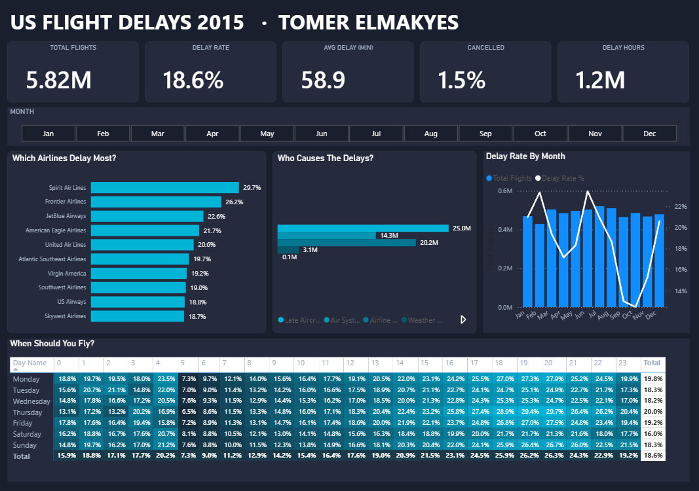

# ✈️ US Flight Delays 2015 – Power BI Dashboard

An interactive Power BI dashboard analysing **5.8 million U.S. domestic flights** from the U.S. Department of Transportation (DOT) 2015 on-time performance dataset.

## Key numbers
| Total flights | Delay rate | Avg. delay | Cancelled | Delay hours |
|---|---|---|---|---|
| 5.82M | 18.6% | 58.9 min | 1.5% | 1.2M |

## Questions the dashboard answers
- **Which airlines delay most?** Spirit (29.7%) and Frontier (26.2%) lead the delay ranking.
- **Who causes the delays?** Late-arriving aircraft and airline-related causes account for most delay minutes.
- **How does delay change by month?** The delay rate peaks in February and June and is lowest in September–October.
- **When should you fly?** A day × hour heatmap shows early-morning flights (5–6 AM) have the lowest delay rate (~7%).

## How it was built
1. **Data cleaning – Python (Pandas):** read the 590 MB `flights.csv` in chunks, kept the relevant columns, created flags (delayed / on-time) and mapped cancellation reasons → [`clean_flights.py`](clean_flights.py)
2. **Data model – Power BI:** flights fact table linked to airlines, airports and a DAX date table.
3. **DAX measures:** total / operated / cancelled flights, delay rate, average delay, delay hours and more.
4. **Dashboard:** KPI cards, month slicer, bar charts, combo chart and a conditional-formatted heatmap.

## Tools
`Python` · `Pandas` · `Power BI` · `DAX` · `Power Query`

## Data source
U.S. DOT Bureau of Transportation Statistics – 2015 Flight Delays and Cancellations (flights, airlines, airports).

## Files
- `us_flight_delays_2015.pbix` – the Power BI report (47 MB, too large for GitHub upload; available on request)
- `clean_flights.py` – the data-cleaning script
- `dashboard.png` – dashboard screenshot

---
**Tomer Elmakyes** · Junior Data Analyst · [LinkedIn](https://www.linkedin.com/in/tomer-elmakyes-0824b8425/)
